# HeatSafe-ML 🌡️🛰️

### Geospatial Machine Learning & Environmental Intelligence for Urban Heat Resilience in Nagpur, Maharashtra, India

HeatSafe-ML is an end-to-end geospatial machine learning platform and environmental intelligence backend engineered to quantify, model, and serve high-resolution urban heat exposure across Nagpur, Maharashtra.

By integrating multispectral and thermal satellite observations from **Landsat 8/9 Collection 2 Level-2**, digital surface elevation from **Copernicus DEM GLO-30**, and machine-learned spatial feature representations, HeatSafe-ML surfaces granular thermal patterns across urban morphology to empower researchers, urban planners, public health authorities, and civic communities with verifiable, reproducible climate intelligence.

> **Current Operational Status (Branch 1 - Backend & ML):**  
> - **Roadmap:** Plan v2 (adopted 2026-11-09) — production backend for a public-facing app, citizens first, at zero recurring cost (Decisions D8–D10, T1–T18 in [`progress.md`](progress.md)).  
> - **Active Phase:** Phase 12 (Hardening & Zero-Cost Deployment). Phases 0–9 and 11 closed; Phase 10 open only on its 14-day scheduled-run check. **Public API v1 is frozen and ready for the frontend**  
> - **Completed Milestones:** Phase 0 (Foundation Architecture), Phase 1 (Study Area & Master Grid), Phase 2 (STAC Ingestion Pipeline), Phase 3 (Preprocessing, QA Masking & Feature Engineering)  
> - **Branch 2 (Frontend UI):** 🔒 **LOCKED** under Two-Branch Governance until full Backend Acceptance Gate verification.  
> - **Live Test Suite:** 128/128 unit & integration tests passing (`python -m pytest -v`, verified 2026-11-13); backend branch coverage 94%.

---

## 📑 Table of Contents

- [The Urban Heat Challenge in Nagpur](#-the-urban-heat-challenge-in-nagpur)
- [Scientific Foundations & Target Variable Decoupling](#-scientific-foundations--target-variable-decoupling)
- [Study Area & Geospatial Specifications](#-study-area--geospatial-specifications)
- [System Architecture & Engineering Standards](#-system-architecture--engineering-standards)
- [Repository Layout & File Directory](#-repository-layout--file-directory)
- [Data Ingestion & Provenance Engine](#-data-ingestion--provenance-engine)
- [Governance & The Root Triad](#-governance--the-root-triad)
- [Development Roadmap & Phasewise Milestones](#-development-roadmap--phasewise-milestones)
- [Getting Started & Local Development](#-getting-started--local-development)
- [Testing & Quality Verification](#-testing--quality-verification)
- [Scientific Integrity & Ethical Disclaimers](#-scientific-integrity--ethical-disclaimers)

---

## 🏙️ The Urban Heat Challenge in Nagpur

Nagpur is located in the Vidarbha region of central India, characterized by a tropical wet-and-dry climate with extreme summer heatwaves where peak ambient dry-bulb temperatures regularly exceed 44°C to 48°C. Rapid urbanization, loss of green canopy, and high concentrations of impervious surfaces (asphalt, concrete, brick masonry) exacerbate the **Urban Heat Island (UHI)** effect, trapping solar radiation and creating severe microclimatic disparities.

### Why Point Observations Fall Short
Standard weather monitoring relies on single-point weather stations (such as IMD Sonegaon [WMO ID 42867] or sparse CPCB CAAQMS air quality stations). While accurate for synoptic forecasts, a single regional air temperature reading fails to capture intra-urban thermal variance. Surface temperatures can fluctuate by more than 12°C across different neighborhoods depending on tree canopy cover, water bodies, building density, and surface materials.

HeatSafe-ML systematically bridges this gap by decoupling satellite skin temperature, ambient air temperature, and physiological heat index into an auditable machine learning workflow.

---

## 🔬 Scientific Foundations & Target Variable Decoupling

A core tenet of HeatSafe-ML is strict physical science discipline: **satellite-derived surface temperature is not equivalent to ambient air temperature, and exposure is not equivalent to vulnerability**. HeatSafe-ML strictly decouples these physical phenomena across separate modeling stages:

| Target Variable | Physical Meaning | Primary Data Source | Native Sensor Resolution | Model Target Stage | Evaluation Metrics | Baseline Benchmark |
| :--- | :--- | :--- | :--- | :--- | :--- | :--- |
| **Land Surface Temperature (LST, °C)** | Radiative skin temperature of ground materials, canopy, and built surfaces | Landsat 8/9 Collection 2 L2 (`ST_B10`) | ~100 m thermal (resampled to 30 m by USGS) | **Model 1** (Phase 5) | Spatial RMSE, MAE, $R^2$, Residual Moran's I | Historical spatial cell-mean climatology |
| **Station Air Temperature ($T_{air}$, °C)** | Ambient dry-bulb temperature at 2 m height in shaded, ventilated Stevenson screens | IMD Sonegaon (42867) & CPCB CAAQMS (Civil Lines, Ambazari) | Point station observations | **Model 2** (Post-Gate) | Point RMSE, MAE, Mean Bias Error (MBE) | Nearest-neighbor station observation / IDW |
| **Heat Index (Apparent Temp, °C)** | Steadman physiological apparent temperature combining $T_{air}$ and relative humidity | Derived from station sensors & ERA5-Land reanalysis | Point / 0.1° reanalysis grid (~11 km) | **Model 3** (Post-Gate) | Category classification accuracy (NOAA brackets), MAE | Point-station direct formula computation |

### Physical Reality of Central India Summers
During Nagpur summers (March–May), intense solar insolation on low-albedo, impervious urban surfaces elevates satellite LST **10°C to 18°C higher** than 2 m ambient air temperature. LST and $T_{air}$ are never conflated or substituted for one another.

### Analytical Grid Transparency (Decision D6)
The HeatSafe-ML analytical master grid is rasterized at **30 m cell resolution**. This matches Landsat multispectral reflectance and Copernicus DEM rasters. However, because Landsat thermal infrared (TIRS Band 10) is natively acquired at ~100 m resolution and resampled to 30 m by USGS using cubic convolution, HeatSafe-ML explicitly reports model performance on the 30 m analytical grid without falsely claiming 'street-level ground accuracy'.

---

## 🗺️ Study Area & Geospatial Specifications

The study area covers the administrative jurisdiction of the **Nagpur Municipal Corporation (NMC)** and surrounding microclimatic transition zones:

```text
Study Area: Nagpur Urban Area, Maharashtra, India
Center Coordinates: 21.1458°N, 79.0882°E
Geographic CRS: EPSG:4326 (WGS 84)
Projected Analytical CRS: EPSG:32644 (UTM Zone 44N)
Bounding Box (WGS84): [78.9500°E, 21.0500°N] to [79.2000°E, 21.2500°N]
Master Projected Grid Extent:
  - Easting (X):  285,960.0 m to 314,220.0 m (Width: 28,260 m)
  - Northing (Y): 2,328,030.0 m to 2,351,880.0 m (Height: 23,850 m)
  - Dimensions: 942 columns × 795 rows = 748,890 total cells
  - Cell Resolution: 30.0 m × 30.0 m
  - Spatial Buffer: 1,000 m (1 km) surrounding urban boundary
```

### Administrative Boundaries
- **City Boundary:** Official NMC boundary vector stored at [`ml/data/raw/boundary/nagpur_nmc.geojson`](file:///C:/Users/aayus/heatsafe-ML/ml/data/raw/boundary/nagpur_nmc.geojson) (OSM Relation 12969115, 387 vertices, EPSG:4326).
- **Administrative Zones:** Ingested 10 official NMC administrative zones stored at [`ml/data/raw/boundary/nagpur_zones.geojson`](file:///C:/Users/aayus/heatsafe-ML/ml/data/raw/boundary/nagpur_zones.geojson) (*Laxmi Nagar, Dharampeth, Hanuman Nagar, Dhantoli, Nehru Nagar, Gandhibagh, Satranjipura, Lakadganj, Ashi Nagar, Mangalwari*).
- **1 km Spatial Buffer Justification:** Prevents border-pixel truncation during spatial convolutions, captures rural-urban peripheral thermal gradients, and ensures clean alignment when snapping bounding boxes to integer multiples of 30 meters.

---

## 🏗️ System Architecture & Engineering Standards

HeatSafe-ML is architected with strict separation of concerns, defensive programming, and production-grade software patterns.

```mermaid
flowchart TD
    GEO["PROJECT: HeatSafe-ML (Nagpur, India)"]

    GEO --> FE["Branch 2: Frontend UI (LOCKED)"]
    GEO --> BE["Branch 1: Backend API (backend/) (ACTIVE)"]
    GEO --> ML["Branch 1: ML & Geospatial (ml/) (ACTIVE)"]
    GEO --> GOV["Project Governance (Triad Documents)"]

    subgraph BackendArch ["Backend 4-Layer Architecture"]
        BE --> BE_MAIN["main.py (ASGI Uvicorn Entrypoint)"]
        BE --> BE_ROUTE["core/apis/routes/ (HTTP Endpoint Handlers)"]
        BE_ROUTE --> BE_CTRL["core/controllers/ (Business Orchestration)"]
        BE_CTRL --> BE_CRUD["core/cruds/ (Database Persistence)"]
        BE_CTRL --> BE_SVC["core/services/ (System Services)"]
        BE_CRUD --> BE_DB["core/database/ (SQLAlchemy 2.0 Engine & Base)"]
        BE_CRUD --> BE_MODEL["core/models/ (Declarative ORM Models)"]
    end

    subgraph MLArch ["ML & Geospatial Engine"]
        ML --> ML_CONF["configs/ (study_area.yaml, ingest.yaml, thresholds.yaml)"]
        ML --> ML_INGEST["src/ingest/ (STAC Query, SAS Signing, Tile Download)"]
        ML --> ML_COMMONS["src/commons/ (manifest.py SHA-256, logger.py)"]
        ML --> ML_DATA["data/ (data_manifest.json, raw boundaries & rasters)"]
        ML --> ML_PREPROC["src/preprocess/ (Phase 3: Alignment, QA Masking & Features)"]
        ML --> ML_VALID["src/validate/ (Phase 3: Feature Table Schema Checks)"]
    end

    subgraph ServingPlan ["Plan v2 Serving Path (PLANNED, zero cost)"]
        ML_PREPROC --> PUB["Published Products (Phase 9: COGs, tiles, zone tables)"]
        PUB --> PG["Neon Postgres + PostGIS (free tier)"]
        PUB --> API["Public API v1 on Hugging Face Spaces (Phase 11)"]
        PG --> API
        CRON["GitHub Actions scheduled pipeline (Phase 10)"] --> PUB
    end

    subgraph GovernanceTriad ["The Root Triad"]
        GOV --> G_README["README.md (Rules, Scope & Documentation)"]
        GOV --> G_AGENT["agent.md (Agent OS & Coding Standards)"]
        GOV --> G_PROG["progress.md (Two-Branch Phase Tracker)"]
    end
```



### The 4-Layer Backend Architecture
Every API capability strictly traverses a unidirectional 4-layer flow:
1. **API Route ([`backend/core/apis/routes/`](file:///C:/Users/aayus/heatsafe-ML/backend/core/apis/routes)):** Thin HTTP endpoint declarations, route decorators, request/response model mapping, and HTTP exception translation. Zero database or business logic.
2. **Controller ([`backend/core/controllers/`](file:///C:/Users/aayus/heatsafe-ML/backend/core/controllers)):** Application flow control, transaction boundaries, and orchestration between services and CRUD operations.
3. **Service / CRUD ([`backend/core/services/`](file:///C:/Users/aayus/heatsafe-ML/backend/core/services) & [`backend/core/cruds/`](file:///C:/Users/aayus/heatsafe-ML/backend/core/cruds)):**
   - *Services:* Stateless domain algorithms and system-level checks.
   - *CRUD:* Isolated database interactions via SQLAlchemy sessions.
4. **Model / Database ([`backend/core/models/`](file:///C:/Users/aayus/heatsafe-ML/backend/core/models) & [`backend/core/database/`](file:///C:/Users/aayus/heatsafe-ML/backend/core/database)):** Declarative SQLAlchemy 2.0 ORM entities and hardened connection pooling.

### Inviolable Structural Rules
Development is governed by three permanent architectural invariants:
1. **Strict 2-File-Per-Folder Limit:** Every parent directory contains at most two child executable code files (`.py`, `.jsx`, `.tsx`). Modules are decomposed logically rather than clustered.
2. **Single Root `.gitignore` & `requirements.txt`:** Exactly one root [`.gitignore`](file:///C:/Users/aayus/heatsafe-ML/.gitignore) and one root [`requirements.txt`](file:///C:/Users/aayus/heatsafe-ML/requirements.txt) across the entire repository.
3. **Markdown Freeze (`.md` Triad):** No arbitrary markdown files. All documentation, decision records, and operational instructions are consolidated inside [`README.md`](file:///C:/Users/aayus/heatsafe-ML/README.md), [`agent.md`](file:///C:/Users/aayus/heatsafe-ML/agent.md), and [`progress.md`](file:///C:/Users/aayus/heatsafe-ML/progress.md).

---

## 📁 Repository Layout & File Directory

```text
heatsafe-ML/
├── README.md                              # Authoritative project guide, science, and documentation
├── agent.md                               # IDE agent constitution, 4-layer rules, and coding standards
├── progress.md                            # Two-branch milestone execution tracker (Phases 0-10)
├── architecture.mmd                       # Source Mermaid system architecture diagram
├── requirements.txt                       # Single consolidated production dependencies
├── .gitignore                             # Single root version control ignore rules
├── heatsafe.sqlite3                       # Local transactional persistence store
├── .github/
│   └── workflows/
│       └── ci.yml                         # Automated continuous integration workflow
├── backend/
│   ├── main.py                            # ASGI entrypoint script with environment resolution
│   ├── commons/
│   │   ├── auth.py                        # Authentication and security helper utilities
│   │   └── logger.py                      # Backend structured logger
│   ├── core/
│   │   ├── __init__.py                    # Core module namespace
│   │   ├── apis/
│   │   │   ├── api.py                     # FastAPI application factory & router composition root
│   │   │   ├── routes/
│   │   │   │   └── health.py              # Health check and diagnostic echo HTTP routes
│   │   │   └── schemas/
│   │   │       ├── requests/
│   │   │       │   └── health_request.py  # Pydantic v2 request contracts
│   │   │       └── responses/
│   │   │           └── health_response.py # Pydantic v2 response contracts
│   │   ├── controllers/
│   │   │   └── health_controller.py       # Health lifecycle orchestration controller
│   │   ├── cruds/
│   │   │   └── health_crud.py             # Database heartbeat execution queries
│   │   ├── database/
│   │   │   ├── base_class.py              # SQLAlchemy 2.0 DeclarativeBase parent
│   │   │   └── database.py                # Database engine & sessionmaker generator
│   │   ├── models/
│   │   │   └── health_model.py            # System health event ORM entity
│   │   └── services/
│   │       └── system_service.py          # Uptime, memory, and runtime diagnostic service
│   └── tests/
│       └── test_health.py                 # Backend API endpoint test suite
└── ml/
    ├── configs/
    │   ├── ingest.yaml                    # STAC search, collection names, and retry policies
    │   ├── study_area.yaml                # Nagpur bounding box, UTM grid, and WGS84 CRS
    │   └── thresholds.yaml                # Scientific thresholds, cloud limits, and baselines
    ├── data/
    │   ├── manifest/
    │   │   └── data_manifest.json         # Cryptographic SHA-256 data provenance manifest
    │   ├── processed/
    │   │   └── features_v1.parquet        # Phase 3 training table (git-ignored, hash in manifest)
    │   └── raw/
    │       ├── boundary/
    │       │   ├── nagpur_nmc.geojson     # Official NMC municipal boundary vector
    │       │   └── nagpur_zones.geojson   # 10 official NMC administrative zones vector
    │       └── landsat/                   # Ingested Landsat 8/9 Level-2 GeoTIFF rasters
    ├── src/
    │   ├── commons/
    │   │   ├── logger.py                  # ML structured logging utility
    │   │   └── manifest.py                # Atomic DataManifestManager with SHA-256 hashing
    │   ├── ingest/
    │   │   ├── sources.py                 # STAC Planetary Computer client with SAS signing
    │   │   └── __main__.py                # Ingestion CLI orchestrator with seasonal audit
    │   ├── preprocess/
    │   │   ├── align.py                   # Reprojection / resampling onto the 30 m master grid
    │   │   └── features.py                # QA masking, LST scaling, spectral indices, terrain & temporal features
    │   └── validate/
    │       └── schema.py                  # FeatureTableSchema dtype, range, and missingness checks
    └── tests/
        ├── test_smoke.py                  # Configuration and logger smoke tests
        ├── test_study_area.py             # GeoJSON geometry, CRS, and grid snapping tests
        ├── ingest/
        │   └── test_ingest.py             # STAC client, retry, and manifest audit tests
        └── preprocess/
            └── test_preprocess.py         # Grid alignment, masking, and feature table tests
```

---

## 🛰️ Data Ingestion & Provenance Engine

The ingestion subsystem queries Microsoft Planetary Computer STAC APIs to acquire surface reflectance and thermal observations:

### Target Satellite Data Bands
- **Landsat 8 & 9 Collection 2 Level-2 (`landsat-c2-l2`):**
  - Path: `144` | Row: `045` (Nagpur coverage)
  - `ST_B10`: Surface Temperature thermal infrared band (Kelvin × 0.00341802 + 149.0 converted to °C)
  - `QA_PIXEL`: Pixel quality assessment bitmask (cloud, cloud shadow, cirrus, water, dilations)
  - `QA_RADSAT`: Radiometric saturation flags
  - `SR_B3` (Green), `SR_B4` (Red), `SR_B5` (Near-Infrared), `SR_B6` (Shortwave-Infrared 1) for spectral index calculation
- **Copernicus DEM GLO-30 (`cop-dem-glo-30`):**
  - High-precision 30 m digital elevation tiles (`Copernicus_DSM_COG_10_N21_00_E078_00_DEM`, `Copernicus_DSM_COG_10_N21_00_E079_00_DEM`) for elevation, slope, and topographic aspect derivation.

### Cryptographic Provenance Tracking ([`DataManifestManager`](file:///C:/Users/aayus/heatsafe-ML/ml/src/commons/manifest.py))
Every downloaded raster and vector boundary is registered in [`ml/data/manifest/data_manifest.json`](file:///C:/Users/aayus/heatsafe-ML/ml/data/manifest/data_manifest.json). The manifest records:
- Source catalogue and unique scene ID
- ISO acquisition timestamp and recording timestamp
- File size in bytes and complete cryptographic **SHA-256 hash**
- Full metadata including bounding coordinates, WRS path/row, cloud cover percentage, and band mappings
- Atomic persistence with `.tmp` swapping to guarantee data integrity across system reboots

### Seasonal Distribution Audit (Decision D7)
Training data (2019-01-01 to 2025-12-31) enforces a minimum of **40 cloud-free scenes** ($\le 20\%$ cloud cover) with at least **8 scenes per season**:
- **Summer:** March 1 – May 31 (Peak heat stress)
- **Monsoon:** June 1 – September 30 (Cloud filtering challenge)
- **Post-Monsoon:** October 1 – November 30 (Thermal transition)
- **Winter:** December 1 – February 28/29 (Baseline low-insolation)

---

## ⚖️ Governance & The Root Triad

All agent operations, developer modifications, and roadmap tracking adhere to three master triad documents:

1. **[`README.md`](file:///C:/Users/aayus/heatsafe-ML/README.md) (Project Rules & Regulations):** The authoritative definition of scope, scientific decoupling, analytical standards, and setup instructions.
2. **[`agent.md`](file:///C:/Users/aayus/heatsafe-ML/agent.md) (Agent Operating System):** The immutable constitution governing IDE agent execution, coding standards, 4-layer backend flow, and inviolable rules.
3. **[`progress.md`](file:///C:/Users/aayus/heatsafe-ML/progress.md) (Phasewise Milestone Tracker):** The live, two-branch progress ledger with concrete, verifiable exit criteria for Phases 0 through 10.

### Two-Branch Development Governance
- **Branch 1 (Backend & ML):** Active branch. Covers data ingestion, preprocessing, ML feature engineering, baseline benchmarking, and the production FastAPI backend.
- **Branch 2 (Frontend UI):** 🔒 **Strictly locked**. No frontend code or scaffolding is generated until the Backend Acceptance Gate is satisfied and the project owner explicitly issues the directive: *"move to frontend"*.

---

## 🗺️ Development Roadmap & Phasewise Milestones

Progress is strictly gated across thirteen defined phases (Plan v2, Decision D8) in [`progress.md`](file:///C:/Users/aayus/heatsafe-ML/progress.md):

| Phase | Description | Focus Area | Status | Key Deliverables & Exit Criteria |
| :---: | :--- | :--- | :---: | :--- |
| **0** | **Foundation Architecture** | Backend / Governance | **`[x]` DONE** | 4-layer structure, test runner, CI workflow, single requirements & gitignore |
| **1** | **Study Area & Data Audit** | Geospatial / ML | **`[x]` DONE** | NMC boundary & 10 zones in EPSG:4326/32644, master 30 m grid, data catalog audit |
| **2** | **Incremental Ingestion** | Ingestion Engine | **`[x]` DONE** | Planetary Computer STAC client, SAS signing, retry backoff, SHA-256 manifest |
| **3** | **Preprocessing & Features** | Feature Pipeline | **`[x]` DONE** | QA pixel cloud/shadow masking, NDVI, NDBI, MNDWI, Copernicus DEM slope/aspect, `features_v1.parquet` |
| **4** | **Backend Foundation Hardening** | Backend / Security | **`[x]` DONE** | Typed settings, Postgres + PostGIS, Alembic migrations, error envelope, CORS & secrets fixed, pinned deps, ruff + mypy |
| **5** | **First Working Result & Baselines** | Analysis & Baseline | **`[x]` DONE** | Seasonal LST maps, Gi* hotspots, Baselines 1–3 locked as the bar to beat |
| **6** | **Model 1 Development** | Machine Learning | **`[x]` DONE** | LightGBM/RF on CPU, 2 km spatial-block CV, leakage test, 90% quantile intervals, RMSE ≥ 15% better than Baseline 3 |
| **7** | **Validation & Model Card** | Verification | **`[x]` DONE** | Held-out 2026 test opened once, bootstrap CIs, Model Card, owner Go/No-Go |
| **8** | **Exposure, Vulnerability & Cooling Assets** | Risk Analytics | **`[x]` DONE** | Exposure Index 0–100, zone vulnerability & ranks with intervals, OSM cooling assets |
| **9** | **Versioned Data Products** | Publishing | **`[x]` DONE** | COGs, pre-rendered tiles, PostGIS zone tables, atomic "latest" pointer, hashed bundles |
| **10** | **Automated Inference Pipeline** | Pipeline | **`[~]` SCHEDULE PENDING** | Scheduled GitHub Actions run, freshness flags (`scene_age_days ≤ 16`), fallback, 4 failure-injection tests |
| **11** | **Public API v1** | FastAPI Endpoints | **`[x]` DONE** | `/heat`, `/zones`, `/cooling-spots`, `/tiles`, `/hotspots`; warm p95 ≤ 200 ms, coverage ≥ 85%, frozen OpenAPI contract |
| **12** | **Hardening & Zero-Cost Deployment** | Deployment | **`[~]` NEXT** | Hugging Face Spaces + Neon, Docker, monitoring, backups & restore test, ₹0 recurring cost |

### Zero-Cost Infrastructure (Decision D10)
HeatSafe-ML is built and operated at ₹0 recurring cost. The API never runs the model per request; the pipeline publishes versioned products and the API only reads them.

| Need | Free service |
| :--- | :--- |
| API hosting | Hugging Face Spaces (Docker); Render free tier as fallback |
| Database | Neon free tier (PostgreSQL + PostGIS); Docker Compose Postgres locally |
| Live pipeline scheduler | GitHub Actions scheduled workflow |
| Product storage | Hugging Face Dataset repo / GitHub Releases |
| CI, dependency & security scans | GitHub Actions, `pip-audit` |
| Monitoring | UptimeRobot; Sentry free tier (optional) |
| Backups | Nightly `pg_dump` via GitHub Actions |

**Known free-tier limitation:** the hosted API sleeps when idle, so the first request after a quiet period is slow (cold start). Latency targets are measured on a warm instance and cold-start time is documented separately.

### Third-Party Data Credits
- **Landsat 8/9 Collection 2 Level-2** — USGS, via Microsoft Planetary Computer.
- **Copernicus DEM GLO-30** — © DLR e.V. 2010–2014 and © Airbus Defence and Space GmbH 2014–2018, provided under COPERNICUS by the European Union and ESA.
- **Population** — WorldPop (www.worldpop.org), 2020 1 km unconstrained grids, CC BY 4.0.
- **Boundaries and cooling assets** — © OpenStreetMap contributors, ODbL.
- **Locality names and boundaries** — traced from the Nagpur Municipal Corporation intention map for the revised development plan (1:25,000); approximate (~100 m), not a legal boundary.

---

## 🚀 Getting Started & Local Development

### Prerequisites
- **Operating System:** Windows, Linux, or macOS
- **Python:** Version 3.13 (used by CI and development); 3.12 also installs. 3.11 is not supported (rasterio 1.5 needs 3.12+)
- **C/C++ Build Tools:** Required for binary wheels of geospatial libraries (`rasterio`, `shapely`) if precompiled wheels are not cached.

### 1. Environment Setup
Clone the repository and create an isolated virtual environment:
```bash
# Clone the repository
git clone https://github.com/Aayush-Dubey123/heatsafe-ML.git
cd heatsafe-ML

# Create virtual environment
python -m venv .venv

# Activate virtual environment
# Windows (PowerShell):
.venv\Scripts\Activate.ps1
# Linux / macOS:
source .venv/bin/activate
```

### 2. Install Dependencies
Install all pinned production and development dependencies using the single root requirements file:
```bash
pip install --upgrade pip
pip install -r requirements.txt
```

### 3. Configure Environment & Database
Settings come only from `HEATSAFE_*` environment variables or a root `.env` file (git-ignored); the app refuses to start without a valid configuration.
```bash
cp .env.example .env               # then set HEATSAFE_DB_PASSWORD and matching HEATSAFE_DATABASE_URL
docker compose up -d db            # PostgreSQL 16 + PostGIS on 127.0.0.1:5432
alembic -c backend/alembic.ini upgrade head
```

### 4. Running the Backend API Server
Start the FastAPI server via the ASGI Uvicorn runner:
```bash
python backend/main.py
```
*Alternatively, run directly with live reload during development:*
```bash
uvicorn backend.core.apis.api:app --host 0.0.0.0 --port 8000 --reload
```
Once launched, explore the interactive OpenAPI documentation:
- **Swagger UI:** [http://127.0.0.1:8000/docs](http://127.0.0.1:8000/docs)
- **ReDoc Documentation:** [http://127.0.0.1:8000/redoc](http://127.0.0.1:8000/redoc)
- **Service Health Check:** [http://127.0.0.1:8000/api/v1/health](http://127.0.0.1:8000/api/v1/health)

### 5. Running the Geospatial Ingestion CLI
The ingestion CLI provides commands for auditing and downloading satellite rasters:
```bash
# Perform a dry-run audit of available Landsat scenes without downloading
python -m ml.src.ingest --source landsat --dry-run

# Ingest and verify Copernicus DEM elevation tiles
python -m ml.src.ingest --source dem --dry-run

# Execute live scene ingestion for a targeted date range
python -m ml.src.ingest --source landsat --start-date 2024-01-01 --end-date 2024-05-31 --max-cloud 15.0
```

### 6. Using the API
With the server running (step 4) and a product bundle in `ml/data/published/` (build one with `python -m ml.src.publish.products`, or fetch the latest with `python -m ml.src.sync.storage restore-bundle`), the interactive docs are at `/docs`. Examples:
```bash
curl "http://127.0.0.1:8000/api/v1/metadata"
curl "http://127.0.0.1:8000/api/v1/heat?lat=21.1458&lon=79.0882"
curl "http://127.0.0.1:8000/api/v1/zones?season=summer"
curl "http://127.0.0.1:8000/api/v1/cooling-spots?lat=21.1458&lon=79.0882&limit=5"
curl -o tile.png "http://127.0.0.1:8000/api/v1/tiles/latest_lst/12/2947/1800.png"
```
Errors always look like `{"error": {"code", "message", "details", "request_id"}}`. The OpenAPI contract is frozen in `backend/tests/api/openapi_v1.json`; to change it on purpose run the tests with `UPDATE_OPENAPI_SNAPSHOT=1`.

---

## 🧪 Testing & Quality Verification

HeatSafe-ML maintains rigorous test coverage spanning unit tests, geospatial coordinate math, schema serialization, and API route integration.

### Execute All Tests
Run pytest from the repository root:
```bash
python -m pytest -v
```

Backend tests use a throwaway SQLite database by default and run all Alembic migrations first (and roll them back afterwards). To run them against PostgreSQL + PostGIS, use a separate test database so your dev data is untouched:
```bash
docker exec heatsafe-db createdb -U heatsafe heatsafe_test
HEATSAFE_TEST_DATABASE_URL=postgresql+psycopg://heatsafe:<password>@127.0.0.1:5432/heatsafe_test python -m pytest backend -v
```
Use `127.0.0.1` rather than `localhost`: on Windows, `localhost` tries IPv6 first and connections stall.

### Lint, Type Check & Dependency Audit
```bash
ruff check backend --line-length 120 --target-version py312 --select E,F,W,I,B,S,UP --ignore B008 --per-file-ignores "backend/tests/*:S101"
mypy backend --python-version 3.13 --ignore-missing-imports --explicit-package-bases --no-site-packages --exclude backend/tests/
pip-audit -r requirements.txt
```

### Run Tests with Coverage Report
Verify line and branch coverage:
```bash
python -m pytest --cov=backend --cov=ml -v
```

### Verification Checklist
- [x] Backend GET `/api/v1/health` and POST `/api/v1/health/ping` endpoints passing
- [x] GeoJSON study boundaries (NMC and 10 zones) topologically valid and in EPSG:4326
- [x] Master projected grid coordinates perfectly snapped to 30 m increments in EPSG:32644
- [x] STAC ingestion retry policies, exponential backoff, and seasonal inventory categorization verified
- [x] Cryptographic SHA-256 data manifest manager atomic writes verified
- [x] Phase 3 grid alignment, QA masking, and `features_v1.parquet` schema checks verified (0.16% missingness)

---

## 🧾 Model Card — Model 1 (Land Surface Temperature)

| | |
| :--- | :--- |
| **Version** | `m1-20261109T150313Z` (LightGBM, CPU) |
| **Predicts** | Land surface temperature (LST, °C) on the 30 m analytical grid at the Landsat overpass (~10:00 local solar time), with a 90% range. **Not** air temperature, **not** heat index (Decision D1). |
| **How** | Gradient-boosted trees predict each pixel's difference from the scene's mean LST, then training residuals of the same scene are interpolated (IDW). Lower/upper bounds come from 5th/95th-percentile quantile models. |
| **Inputs** | NDVI, NDBI, MNDWI at the pixel and averaged over 150 m and 450 m; elevation, slope, aspect (Copernicus DEM); day of year; mean solar time; the scene's mean LST over its observed clear pixels. |
| **Training data** | 122 Landsat 8/9 Collection 2 Level-2 scenes, 2019-01-08 to 2025-12-18, WRS path 144 / row 45; 1.95 M sampled pixels from 144 of 180 two-kilometre blocks. Open water and cloud/shadow pixels excluded. |
| **Tuning** | 30-trial random search with spatial-block cross-validation; seeds fixed. |

### Performance

Final test, opened once (2026-11-10): pixels in 36 two-kilometre blocks the model never saw.

| Test group | Model 1 RMSE [95% CI] | Baseline 3 RMSE | MAE | Bias | R² | 90% range covers |
| :--- | :---: | :---: | :---: | :---: | :---: | :---: |
| 2026 scenes (28 scenes, 112,973 pixels) | **1.36 °C** [1.28, 1.44] | 2.43 °C | 1.00 °C | +0.05 °C | 0.975 | 87.1% |
| 2019–2025 scenes (122 scenes, 493,105 pixels) | 1.21 °C [1.15, 1.28] | 2.49 °C | 0.87 °C | +0.01 °C | 0.982 | 88.6% |

2026 RMSE by season: summer 1.42, monsoon 1.68, post-monsoon 1.20, winter 1.06 °C. By surface: built-up 1.42, bare/mixed 1.39, vegetation 1.23 °C (surface classes are an NDVI/NDBI proxy, not a land-cover map). Cross-validation estimate before the test: 1.23 °C.

### Limits and failure modes

- **Needs a satellite scene.** The model fills in and smooths LST for a date on which Landsat observed the city. It does not forecast, and it cannot produce a map for a day with no usable scene. The test measured unseen places within observed scenes, not unseen days without imagery.
- **Clear-sky, daytime only.** One overpass at ~10:00 local solar time every 8 days at best; cloudy days are missing, so monsoon conditions are under-represented (10 training scenes, mostly early June and late September).
- **Surface, not air.** In summer the surface can be 10–18 °C hotter than 2 m air temperature. At the overpass time the built-up city is on average ~2.5 °C *cooler* than the surrounding bare farmland; that says nothing about night-time or air-temperature heat stress.
- **Resolution.** 30 m is the grid; the thermal band is natively ~100 m (Decision D6). No street-level claims.
- **Ranges are slightly too narrow.** The "90%" range contained the truth 87% of the time.
- **Not validated against ground stations.** IMD/CPCB station data could not be obtained automatically; validation is against Landsat LST only.
- **Largest errors:** monsoon scenes and sparsely vegetated or built surfaces.
- **Geography.** Trained and tested on Nagpur only.

---

## 🛡️ Scientific Integrity & Ethical Disclaimers

1. **Surface Temperature vs. Physiological Thermal Comfort:**  
   Satellite-derived Land Surface Temperature (LST) measures the radiative skin temperature of ground, vegetation, and rooftop materials. It is **not** equivalent to 2 m ambient air temperature or the human body's experienced physiological heat index. HeatSafe-ML does not present LST as human exposure without explicit scientific context.
2. **Analytical Resolution & Non-Sub-Meter Precision:**  
   The master grid resolution is 30 meters. This analytical cell size facilitates multi-sensor raster alignment; it does **not** represent sub-meter, parcel-level, or street-level precision.
3. **Civic Research & Non-Operational Status:**  
   HeatSafe-ML is a research platform designed for spatial intelligence, environmental analysis, and policy formulation support. It is **not an official emergency warning system** and does not replace advisories issued by the India Meteorological Department (IMD), National Disaster Management Authority (NDMA), or the Nagpur Municipal Corporation (NMC).
4. **Data Privacy & Social Vulnerability Aggregation:**  
   Any socioeconomic or demographic vulnerability indicators evaluated in Phase 7 are strictly aggregated to administrative zones or anonymized spatial blocks. No individual or household-level data is ingested or processed.

---

**Built with scientific rigor, spatial transparency, and engineering discipline for Nagpur.**
