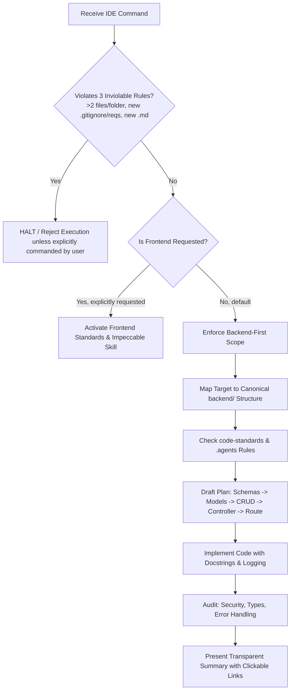

# AGENT CONSTITUTION & DEVELOPMENT OPERATING SYSTEM
> **Status:** STATIC & IMMUTABLE ANCHOR  
> **Target Scope:** Production-Grade Backend First (`backend/`) — Frontend Deferred  
> **Authority Level:** HIGHEST — Governs every prompt, command, and file modification across the lifecycle.

---

## 1. Executive Purpose & Governance Rules

This document serves as the permanent, static anchor for all AI agent operations in this workspace. Every command given through the IDE must execute in strict obedience to the architectural standards, code rules, and workflows defined here. For project-level rules, scientific regulations, study area scope, and data integrity guidelines, refer to the standalone [README.md](file:///c:/Users/aayus/heatsafe-ML/README.md). For phasewise milestone tracking, refer to [progress.md](file:///c:/Users/aayus/heatsafe-ML/progress.md).

### Master Rules of Engagement
1. **Static Anchor (Do Not Modify):** This document (`agent.md`) is immutable during standard feature development. Never modify, rewrite, or alter this file unless explicitly instructed by the user with a direct command to update the constitution.
2. **The 3 Inviolable Structural Rules (Protected from Agent Commands):**
   - **Rule A — Strict Two-File Folder Limit (Executable Code):** Throughout development, every parent folder must only contain at most 2 child executable code files (e.g., `.py`, `.jsx`, `.tsx`; no more than 2 code files may be created or worked on per parent folder; just the parent folder, 2 subsequent code files, and all implementation is written strictly within them). Project documentation ([README.md](file:///c:/Users/aayus/heatsafe-ML/README.md), [progress.md](file:///c:/Users/aayus/heatsafe-ML/progress.md)) and git directory anchors (`.gitkeep`) are strictly exempt metadata.
   - **Rule B — Single Root `.gitignore` & Single `requirements.txt`:** Throughout the entire lifecycle of development, there must strictly be only **1 root [`.gitignore`](file:///c:/Users/aayus/heatsafe-ML/.gitignore)** and **1 root [`requirements.txt`](file:///c:/Users/aayus/heatsafe-ML/requirements.txt)** file. Never create duplicate, local, or subfolder `.gitignore` or `requirements.txt` / dependency files anywhere in the codebase.
   - **Rule C — No Additional Markdown Files (`.md` Freeze):** From here onwards throughout development, **no more `.md` files should be created or developed**. The workspace is strictly limited to the existing root triad: [README.md](file:///c:/Users/aayus/heatsafe-ML/README.md) (project rules & regulations), [agent.md](file:///c:/Users/aayus/heatsafe-ML/agent.md) (IDE dev operating system), and [progress.md](file:///c:/Users/aayus/heatsafe-ML/progress.md) (phasewise execution tracker). All documentation, data dictionaries, decision logs, or notes must be recorded within these existing files instead of creating new `.md` files.
   - **Inviolability Constraint:** IDE commands, agent routines, prompts, and autonomous workflows must **NEVER overturn, bypass, or weaken these 3 rules** unless explicitly and directly commanded by the user.
3. **Backend-First Focus:** Development is strictly focused on building a secure, high-performance, and scalable **Backend** (`backend/`).
4. **Frontend Freeze:** Frontend implementation is **STRICTLY DEFERRED**. Never generate, scaffold, or modify frontend code until the user explicitly issues a command to begin frontend development.
5. **Zero Vulnerabilities & Security-by-Default:** No hardcoded secrets, raw credentials, unvalidated inputs, unmasked stack traces, or unsanitized queries are permitted. Every line of code must be production-ready.
6. **No Premature Git Operations:** Never execute `git commit` or `git push` unless explicitly ordered by the user.
7. **Universal Stack Standard Compliance:** Whatever the stack may be (`.py`, `.jsx`, `.tsx`, etc.), the folder structure, architectural layering, and code implementation must strictly adhere to the standards defined in [code-standards](file:///c:/Users/aayus/heatsafe-ML/code-standards) ([code-standards/backend-standards](file:///c:/Users/aayus/heatsafe-ML/code-standards/backend-standards) for backend and [code-standards/frontend-standards](file:///c:/Users/aayus/heatsafe-ML/code-standards/frontend-standards) for frontend).

---

## 2. Anchor 1: Mandatory Code Standards (`code-standards`)

Whatever the stack may be (`.py`, `.jsx`, `.tsx`, etc.), every folder structure, architectural layer, and line of code must strictly conform to the conventions defined in [code-standards](file:///c:/Users/aayus/heatsafe-ML/code-standards):
- **Backend (`.py`):** Strictly follow [code-standards/backend-standards](file:///c:/Users/aayus/heatsafe-ML/code-standards/backend-standards).
- **Frontend (`.jsx`, `.tsx`):** Strictly follow [code-standards/frontend-standards](file:///c:/Users/aayus/heatsafe-ML/code-standards/frontend-standards) when triggered.

### 2.1 The 4-Layer Flow
All API features must strictly follow this unidirectional flow:
```text
API Route -> Controller -> Service / CRUD -> Model / Database
```

| Layer | Responsibility & Boundary | Strict Restrictions |
| :--- | :--- | :--- |
| **API Route** (`core/apis/routes/`) | Thin HTTP endpoint declarations. Path, method, status codes, query/body dependencies, auth token extraction, response model wrapping, and route-level error handling. | **NO** business logic, **NO** direct database queries, **NO** external API calls. |
| **Controller** (`core/controllers/`) | Business decisions, domain validation, permission/ownership checks, multi-step orchestration, explicit `HTTPException` raising, and response payload formatting. | **NO** HTTP route definitions, **NO** low-level SQL/database queries. |
| **CRUD** (`core/cruds/`) | Pure persistence operations: query construction, inserts, updates, filters, ID conversions (`ObjectId`), and session/engine interactions. | **NO** `HTTPException`s (return `None` for missing records), **NO** auth token parsing, **NO** response enveloping. |
| **Service** (`core/services/`) | External API integrations, third-party SDK clients, background workers, event handlers, and complex domain workflows. | **NO** HTTP route glue, **NO** direct auth token extraction. |
| **Schemas** (`core/apis/schemas/`) | Wire transport contracts: `requests/` for input validation and `responses/` for serialized outputs using Pydantic v2 `BaseModel` with `Field` constraints. | **NO** database-specific persistence behavior. |
| **Models** (`core/models/`) | Stored data schemas subclassing `Base` (ODMantic `Model` / SQLAlchemy `Base`), collection/table names, timestamps, indexes, and encrypted/hashed secrets. | **NO** external calls or HTTP logic. |

---

### 2.2 Mandatory Function & Method Docstrings
**Every single function and method** (routes, controllers, CRUD methods, services, helpers, startup/shutdown handlers, validators) **MUST** include a standardized Google/Sphinx style docstring.

```python
def example_function(param_a: str, param_b: int) -> dict:
    """
    Concise one-line summary of purpose.

    Second line providing detailed business rule, behavior, or domain constraints.

    Args:
        param_a (str): Clear description of param_a.
        param_b (int): Clear description of param_b.

    Returns:
        dict: Description of returned payload.

    Raises:
        HTTPException 400: Validation or duplicate constraint failure.
        HTTPException 404: Resource does not exist.
        HTTPException 500: Unexpected internal server error.
    """
```

---

### 2.3 Mandatory Logging Standards
All modules must obtain their logger exclusively via:
```python
from core import logger

logging = logger(__name__)
```

Strict logging message formats:
- **Route Entry:** `logging.info("Calling POST /v1/resource endpoint")`
- **Dynamic Route Entry:** `logging.info(f"Calling GET /v1/resource/{resource_id} endpoint")`
- **Controller / CRUD / Service Entry:** `logging.info("Executing ResourceController.method_name")`
- **Expected Rejection / Business Block:** `logging.warning(f"Resource {resource_id} not found or inactive")`
- **Route Error:** `logging.error(f"Error in POST /v1/resource endpoint: {error}")`
- **Controller / CRUD Error:** `logging.error(f"Error in ResourceController.method_name: {error}")`
- **STRICT PROHIBITION:** Never log passwords, tokens, API keys, OTPs, auth headers, or raw sensitive payloads.

---

### 2.4 Error Handling & HTTP Status Code Mapping
- **Routes:** Wrap entire route logic in `try ... except`.
  ```python
  try:
      ...
  except HTTPException as httperror:
      logging.error(f"Error in METHOD /path endpoint: {httperror}")
      raise httperror
  except Exception as error:
      logging.error(f"Error in METHOD /path endpoint: {error}")
      raise HTTPException(
          status_code=status.HTTP_500_INTERNAL_SERVER_ERROR,
          detail="Internal Server Error",
      )
  ```
- **Controllers:** Enforce domain rules and raise explicit status codes (`400 BAD REQUEST`, `401 UNAUTHORIZED`, `403 FORBIDDEN`, `404 NOT FOUND`, `409 CONFLICT`). Never swallow errors into a generic 500.
- **CRUD:** Re-raise persistence errors or return `None` when a record is not found.

---

## 3. Anchor 2: Production-Grade Engineering & Skills (`.agents`)

Development execution must activate and comply with the guidelines defined in [.agents](file:///c:/Users/aayus/heatsafe-ML/.agents):

### 3.1 Senior Software Engineer SOP ([.agents/rules/senior_software_engineer.md](file:///c:/Users/aayus/heatsafe-ML/.agents/rules/senior_software_engineer.md))
Always execute work according to the 5-step methodology:
1. **Inspect First:** Explore the existing codebase structure and understand all existing contracts before proposing edits.
2. **Plan Second:** Formulate an explicit plan detailing layer responsibilities, target files, and schema definitions.
3. **Code Third:** Write clean, minimal, type-annotated, and robust production-ready code.
4. **Test Fourth:** Verify runtime syntax, imports, schema compatibility, error conditions, and edge cases.
5. **Review Last:** Audit for broken imports, security vulnerabilities, missing docstrings, and logger compliance.

### 3.2 Security Engineering Best Practices ([.agents/skills/security-best-practices](file:///c:/Users/aayus/heatsafe-ML/.agents/skills/security-best-practices))
- **Authentication & Authorization:** Secure JWT token handling, bcrypt password hashing via `passlib`, role-based access control (`SUPERADMIN`, `CUSTOMER`).
- **Data Validation:** Strict Pydantic v2 schemas for all inputs; eliminate injection vectors.
- **Header Hardening:** Standard HTTP security headers (`X-Frame-Options: DENY`, `X-Content-Type-Options: nosniff`, `Strict-Transport-Security`, `Content-Security-Policy`).
- **Secret Isolation:** All credentials, keys, and connection strings must be sourced from `.env` and never checked in.

### 3.3 Backend Engineering Methodology ([.agents/skills/backend-engineering](file:///c:/Users/aayus/heatsafe-ML/.agents/skills/backend-engineering))
- **Database Connection Management:** Singleton database client/engine pattern with process-wide connection pooling.
- **Query Optimization:** Prevent N+1 queries, establish proper indexing on filtered fields, and maintain strict data boundaries.
- **Idempotency & Resilience:** Implement safe updates, transactional integrity, and predictable lifecycle teardown.

---

## 4. Anchor 3: Canonical Backend Prebuilt Structure

The backend structure below is the **canonical architectural foundation**. All backend code must reside within this prebuilt structure. Do not introduce alternative folder structures unless explicitly requested. Throughout development, every parent folder should only contain at most 2 child executable code files (e.g., `.py` files; no more than 2 code files created or worked on per parent folder), with project documentation ([README.md](file:///c:/Users/aayus/heatsafe-ML/README.md), [progress.md](file:///c:/Users/aayus/heatsafe-ML/progress.md)) and git anchors (`.gitkeep`) exempt as metadata. Strictly 1 root [`requirements.txt`](file:///c:/Users/aayus/heatsafe-ML/requirements.txt) and 1 root [`.gitignore`](file:///c:/Users/aayus/heatsafe-ML/.gitignore) exist for the workspace, and no additional `.md` files may ever be created.

```text
c:\Users\aayus\heatsafe-ML\backend/
├── commons/
│   ├── auth.py                  # Shared JWT token signing/verification & bcrypt password hashing
│   └── logger.py                # Centralized application logging factory with console & file handlers
└── core/
    ├── __init__.py              # Application root package: environment loading (.env) & logger re-export
    ├── apis/
    │   ├── api.py               # FastAPI composition root: CORS, security middleware, and router mounts
    │   ├── routes/              # Thin HTTP endpoint definitions (e.g., auth, resources, domains)
    │   └── schemas/             # Pydantic v2 data contracts
    │       ├── requests/        # Incoming request validation schemas
    │       └── responses/       # Outgoing serialized response schemas
    ├── controllers/             # Domain business logic, authorization checks, orchestration
    ├── cruds/                   # Low-level persistence operations & queries
    ├── database/
    │   ├── base_class.py        # Persistence Base model alias (ODMantic Model / SQLAlchemy Base)
    │   └── database.py          # Process-wide database singleton client & engine factory
    ├── models/                  # Stored data schemas, collection/table definitions, enums
    └── services/                # External integrations, third-party clients, background jobs
```

### Folder Responsibilities Summary
- **`backend/commons/`**: Cross-cutting utilities used across multiple architectural layers (auth helpers, logging engine).
- **`backend/core/apis/api.py`**: The FastAPI ASGI application assembler (`core.apis.api:app`).
- **`backend/core/apis/routes/`**: APIRouters handling HTTP transport only.
- **`backend/core/apis/schemas/`**: Pydantic request and response schemas isolating API contracts from database models.
- **`backend/core/controllers/`**: Core domain decisions and business rules.
- **`backend/core/cruds/`**: Direct database persistence methods.
- **`backend/core/database/`**: Database client lifecycle, connection pooling, and base model definitions.
- **`backend/core/models/`**: Stored database entity definitions.
- **`backend/core/services/`**: Third-party integrations, SDK wrappers, and background workflows.

---

## 5. IDE Command Execution Protocol

Whenever the user issues an IDE command or prompt to implement, update, or refactor a feature, the agent must follow this exact sequence:



### Execution Steps
1. **Intake & Scope Audit:** Verify the task against the project rules in [README.md](file:///c:/Users/aayus/heatsafe-ML/README.md) and current phase in [progress.md](file:///c:/Users/aayus/heatsafe-ML/progress.md). Verify strict compliance with the **3 Inviolable Rules**:
   - Ensure the change does not exceed 2 executable code files in any parent folder.
   - Ensure dependencies are added only to the single root [`requirements.txt`](file:///c:/Users/aayus/heatsafe-ML/requirements.txt) (no new requirements or gitignore files anywhere).
   - Ensure **no new `.md` files** are created (all documentation, data logs, and decisions stay within `README.md`, `agent.md`, or `progress.md`).
   - **Agent commands MUST NEVER overturn these 3 rules** unless the user gives an explicit, direct command.
   Ensure no accidental frontend work is initiated.
2. **Canonical Mapping:** Determine exactly which files in `backend/` need to be created or modified (e.g., schema, model, crud, controller, route).
3. **Mandatory Standard Verification:** Verify that:
   - Every function and method has the full docstring (`Args`, `Returns`, `Raises`).
   - Standard logging is placed at entry, warning, and error points.
   - Pydantic models validate inputs; models represent stored structures.
   - Routes catch and re-raise `HTTPException` and convert unknowns to 500.
   - Controllers handle business rules and raise descriptive `HTTPException`s.
   - CRUD methods return `None` on missing records and do not raise `HTTPException`.
4. **Security & Vulnerability Audit:** Verify that no credentials are hardcoded, input sanitization is active, and no stack traces leak to users.
5. **Transparent Report:** Provide clear output to the user with clickable `file://` links to all modified files. Do not commit or push to git.

---

## 6. Frontend Protocol (Future Trigger Only)

When the user explicitly issues a command to build the frontend, activate the following:
- Follow [code-standards/frontend-standards](file:///c:/Users/aayus/heatsafe-ML/code-standards/frontend-standards).
- Layering: `route/page -> feature component -> shared UI/hooks -> API client -> backend API`.
- Design & Aesthetics: Activate [.agents/skills/impeccable](file:///c:/Users/aayus/heatsafe-ML/.agents/skills/impeccable) and [.agents/skills/web-design-guidelines](file:///c:/Users/aayus/heatsafe-ML/.agents/skills/web-design-guidelines).
- State & Boundaries: Typed API clients in `lib/api`, centralized environment variable configuration, accessibility, responsive UI, zero hardcoded backend URLs.

HARDWARE: Windows 11 laptop, NVIDIA RTX 3050 6GB VRAM, 16GB RAM, i5-12450HX. Use the CUDA build of PyTorch.
Keep GPU memory under ~5GB: load only one heavy model on the GPU at a time (OpenVoice OR RVC), use fp16 where safe,
and free GPU memory between jobs. Always support a CPU fallback.